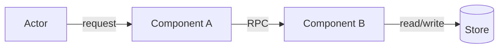

# Threat model

Use when a design adds a data flow, a trust boundary, an asset or an integration. It answers four
questions: what are we building, what can go wrong, what are we doing about it, and did we do a
good enough job. Summarise the result in the doc's Security cross-cutting bullet; keep the model
itself beside the code and update it in the same change that alters a flow or boundary.

## Method

1. **Entry and exit points.** Entry: where external data comes in (endpoints, RPC methods, queue
   consumers, uploads). Exit: where data leaves (responses, webhooks, exports, logs). Group by
   category; exit points matter most for information disclosure.
2. **Trust boundaries.** Every place privilege or network trust changes: internet to internal,
   service to service with different privileges, tenant to tenant. Note how authentication and
   authorisation are enforced at each.
3. **Assets.** Classify from the code and schemas, not from memory: field names and message types
   say what is handled. Record classification, storage location and encryption.
4. **STRIDE per data flow, not per component.** Ask each STRIDE question of each arrow in the
   diagram. Threats live at the transitions.
5. **Be specific.** "An attacker could intercept traffic" is useless. "Anyone on the internal
   network can read unencrypted messages carrying tenant ids on topic `tenant-events`" is a threat.
6. **Choose a response first:** Mitigate, Eliminate, Transfer or Accept. **Accepting a risk is a
   recorded decision, not an omission** — write it in the table with the reason.
7. **A mitigation is `Exists` only if you can point at the code, config or control that implements
   it.** Otherwise it is `Needed` or `Partial`, plus an open question.
8. **Keep threat ids stable across updates.** Append new rows; never renumber (S1, T1, … are cited
   elsewhere).
9. **Check it:** every entry point has at least one threat, every restricted asset has a
   mitigation, and no open question has gone stale.

## Template

````markdown
# Threat model: <system>

<2–4 sentences: what data the system handles and why it matters for security.>

## Entry and exit points

| Direction | Category | Examples | Protocol / format |
|---|---|---|---|
| Entry | | | |
| Exit | | | |

## Trust boundaries

| Boundary | From | To | Authentication / authorisation |
|---|---|---|---|
| | | | |

## Assets

| Asset | Classification | Storage | Encryption |
|---|---|---|---|
| | Restricted / Confidential / Internal / Public | | At rest / in transit / both |

## Data flow



## Threats (STRIDE, per arrow above)

| # | Category | Data flow | Threat |
|---|---|---|---|
| S1 | Spoofing | <Actor → A> | <specific threat> |
| T1 | Tampering | | |
| R1 | Repudiation | | |
| I1 | Information disclosure | | |
| D1 | Denial of service | | |
| E1 | Elevation of privilege | | |

## Mitigations

| Threat # | Response | Control (code / config / infra it lives in) | Status | Priority |
|---|---|---|---|---|
| | Mitigate / Eliminate / Transfer / Accept | | Exists / Needed / Partial | P0–P3 |

## Assumptions

- <Guarantees relied on from infrastructure or upstream, e.g. "the gateway authenticates every
  inbound request". If one is wrong, the model is wrong.>

## Open questions

- [ ] <question> — <owner>, <date>
````
